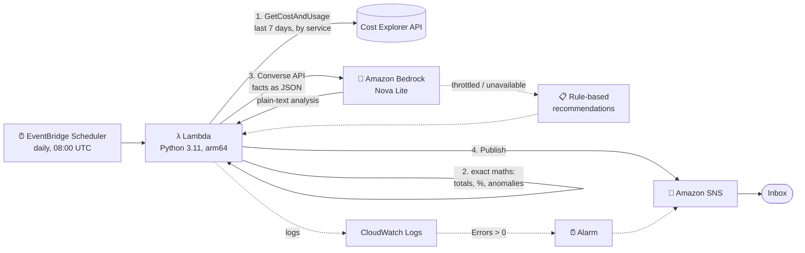

# AI-Driven FinOps Cost Optimizer on AWS

> 💸 **Cloud bills don't spike slowly. They spike overnight.**
>
> A fully serverless tool that emails a cost analysis every morning: exact spend figures, anomaly detection, and cost-saving recommendations written by Amazon Bedrock, with a rule-based fallback so **the report always arrives complete, even when the AI is unavailable**.
>
> **Deployed and running on a real AWS account.** This README covers the live results, including a production Bedrock quota issue and how the design handled it.

     

---

## Table of contents

1. [How it works](#how-it-works)
2. [What the report gives you](#what-the-report-gives-you)
3. [Live results](#live-results)
4. [Production incident: Bedrock daily token quota](#production-incident-bedrock-daily-token-quota)
5. [Design decisions](#design-decisions)
6. [Sample report (anomaly week)](#sample-report-anomaly-week)
7. [Repository layout](#repository-layout)
8. [Prerequisites](#prerequisites)
9. [Deploy it](#deploy-it)
10. [Test it](#test-it)
11. [Configuration](#configuration)
12. [Running cost](#running-cost)
13. [Key learnings](#key-learnings)
14. [Troubleshooting](#troubleshooting)
15. [Next steps](#next-steps)
16. [Clean up](#clean-up)
17. [Skills demonstrated](#skills-demonstrated)

---

## How it works



1. **Amazon EventBridge Scheduler** invokes the Lambda every day at 08:00 UTC (11:00 in Nairobi), with 2 retries.
2. **Lambda** calls the **Cost Explorer API** for the last 7 *complete* days at daily granularity, grouped by service.
3. Python computes the **exact numbers**: total, daily trend, highest-spend day, top services with their % of the bill, and anomalies.
4. The facts go to **Amazon Bedrock** as JSON through the **Converse API**, with automatic retries and back-off. The model writes the narrative and the top 3 recommendations.
5. **If Bedrock fails** (throttling, quota, outage), a **rule-based engine** produces the top 3 recommendations instead.
6. **Amazon SNS** emails the report.
7. A **CloudWatch alarm** notifies you if the Lambda itself fails.

---

## What the report gives you

| Section | Produced by | Content |
|---|---|---|
| ✅ Spend summary | Python (exact) | Total, daily average, trend (rising/flat/falling), highest-spend day, daily bar chart |
| ✅ Top services | Python (exact) | Top 5 services by cost, with % of the total bill |
| ✅ Anomaly detection | Python (exact) | Spikes (≥ 3× baseline **and** ≥ $1/day increase) and **new spend** from forgotten resources, with a projected monthly cost |
| ✅ Interpretation | Bedrock | Likely cause of each anomaly and how to verify it |
| ✅ Top 3 recommendations | Bedrock, **or the rule-based fallback** | Specific, actionable savings for the services you actually use |

---

## Live results

Deployed with Terraform to **us-east-1** on 11 November 2026.

### Deployment

```
$ terraform apply
...
bedrock_model_id     = "us.amazon.nova-lite-v1:0"
lambda_function_name = "finops-cost-optimizer-daily-report"
region               = "us-east-1"
schedule             = "cron(0 8 * * ? *) (UTC)"
sns_topic_arn        = "arn:aws:sns:us-east-1:<account-id>:finops-cost-optimizer-report"
```

### Report 1: 11 Nov 2026, 20:09 UTC (manual run)

```
AWS DAILY COST REPORT
============================================================
Period: 2026-11-04 to 2026-11-10
Total spend: $0.30  (daily average $0.04, trend: rising)
Highest-spend day: 2026-11-07 ($0.30)

Daily totals:
  2026-11-04  $     0.00
  2026-11-05  $     0.00
  2026-11-06  $     0.00
  2026-11-07  $     0.30  ####################
  2026-11-08  $     0.00
  2026-11-09  $     0.00
  2026-11-10  $     0.00

Top services:
  Amazon Relational Database Service            $     0.13   42.2%
  Amazon Elastic Load Balancing                 $     0.09   30.0%
  Amazon Virtual Private Cloud                  $     0.04   14.8%
  Amazon Elastic Compute Cloud - Compute        $     0.03   10.9%
  EC2 - Other                                   $     0.00    0.9%

Anomalies detected: 0

============================================================
AI ANALYSIS (Amazon Bedrock)
============================================================
(AI analysis unavailable: ThrottlingException. The figures above are still exact.)
```

**Reading it:**
- The **$0.30 on 7 November** is my previous project, a [multi-Region Pilot Light DR environment](https://github.com/essiewakukha) (RDS, load balancers, EC2 and VPC in two Regions). It was deployed for testing that day and destroyed afterwards. The report correctly attributed the spend: RDS 42%, ELB 30%, VPC 15%, EC2 11%.
- **0 anomalies is correct.** The increase was below the **$1/day floor**, so cent-level changes don't trigger alerts. That's the noise filter working as designed.
- **Bedrock was throttled, but the report still arrived** with exact figures. Graceful degradation, confirmed in production.

### Report 2: 12 Nov 2026, 09:50 UTC (manual run after the retry fix)

```
Period: 2026-11-05 to 2026-11-11
Total spend: $0.33  (daily average $0.05, trend: falling)
Highest-spend day: 2026-11-07 ($0.30)

Top services:
  Amazon Relational Database Service            $     0.13   38.3%
  Amazon Elastic Load Balancing                 $     0.09   27.3%
  Amazon Virtual Private Cloud                  $     0.04   13.5%
  Amazon Elastic Compute Cloud - Compute        $     0.03    9.9%
  AWS Cost Explorer                             $     0.03    9.1%   ← this tool's own API calls

Anomalies detected: 0
```

**Reading it:**
- **The trend flipped from "rising" to "falling"** as the DR project's spend moved toward the start of the 7-day window. The trend calculation behaves as expected.
- **"AWS Cost Explorer $0.03" appeared.** That's this tool's own API usage ($0.01 per call, 3 calls so far). **The cost monitor is reporting its own cost.**

### Results summary

| Metric | Result |
|---|---|
| Infrastructure deployed (Terraform) | ✅ Lambda, EventBridge Scheduler, SNS, IAM (least privilege), CloudWatch alarm |
| End-to-end pipeline (Scheduler → Lambda → Cost Explorer → SNS → inbox) | ✅ Working |
| Exact cost figures and service attribution | ✅ Matched the DR project's actual footprint |
| Anomaly noise filter ($1/day floor) | ✅ No false positives on cent-level changes |
| Graceful degradation when Bedrock fails | ✅ **Proven in production**: 2 of 2 reports delivered during a Bedrock outage |
| Bedrock AI analysis | ⏳ Blocked by the account's daily token quota (see below). Support case opened |
| Unit tests | ✅ 12 / 12 passing |
| Tool's own cost | $0.03 so far (Cost Explorer API) |

---

## Production incident: Bedrock daily token quota

The most valuable part of this project was debugging a real failure in production.

### Symptom

Every report showed `AI analysis unavailable: ThrottlingException`.

### Investigation

| Step | Hypothesis | Test | Result |
|---|---|---|---|
| 1 | Short burst throttling (requests per minute) | Added **adaptive retries** with exponential back-off (8 attempts) and raised the Lambda timeout from 60 s to 180 s | ❌ Still throttled. `Timeout = 180` confirmed deployed |
| 2 | Lambda- or IAM-specific problem | Called Bedrock **directly from the CLI**, without the Lambda | ❌ `ThrottlingException: Too many tokens per day` |
| 3 | Limited to one model | Tried **Nova Micro** (`us.amazon.nova-micro-v1:0`) | ❌ Same error |
| 4 | Limited to cross-Region inference profiles | Tried **in-Region** Nova Lite (`amazon.nova-lite-v1:0`), which has a separate quota | ❌ Same error |

### Root cause

The error message was the key clue: **"Too many tokens per *day*"**. This isn't a per-minute burst limit; it's a **daily token quota**. It was blocked for every model and every invocation route, which means an **account-level quota**. New AWS accounts can start with very low Bedrock limits until they build up usage history.

**Lesson: retries with back-off fix per-minute throttling but can't fix a daily cap.** Retrying only uses more of the allowance.

### Resolution

1. Opened an **AWS Support service-limit-increase case** for the Amazon Nova Lite *tokens per day* quotas (on-demand and cross-region) in us-east-1. Each report needs only about 2,500 tokens per day.
2. Added a **rule-based recommendation fallback**, so reports stay fully actionable while Bedrock is unavailable, now or during any future outage.
3. **No redeploy is needed when the quota is raised.** The next scheduled run uses Bedrock automatically.

### What the fallback produces

```
============================================================
ANALYSIS (rule-based fallback)
============================================================
AI analysis unavailable (ThrottlingException). The figures above are exact.

TOP 3 RECOMMENDATIONS (rule-based fallback)
1. Amazon Relational Database Service ($0.13, 38.3% of spend): Stop or delete idle RDS
   instances, turn off Multi-AZ and remove read replicas on non-production databases,
   and delete old manual snapshots.
2. Amazon Elastic Load Balancing ($0.09, 27.3% of spend): Delete load balancers with no
   healthy targets or traffic. An idle ALB is still billed every hour.
3. Amazon Virtual Private Cloud ($0.04, 13.5% of spend): Release unused public IPv4
   addresses (billed hourly) and remove unneeded NAT gateways or VPC endpoints.
```

> These are exactly the right actions for the leftover DR-project spend, produced with no AI involved.

### A second finding: missed scheduled run

The first scheduled 08:00 UTC run on 12 November didn't produce an email. The SNS subscription ID in the next email was different from the original one. That shows the subscription had been **recreated** by a later `terraform apply`, and a new email subscription has to be **confirmed again** before SNS delivers to it.
**Lesson:** after any `terraform apply` that touches the SNS subscription, check your inbox for a new confirmation email.

---

## Design decisions

### 1. The code does the maths; the LLM writes the story
LLMs are unreliable at arithmetic. Every number in the email (totals, percentages, ratios, projections) is **computed in Python and unit-tested**. Bedrock gets the facts as JSON, with instructions to *never recalculate or invent numbers*. The AI adds interpretation, likely causes and recommendations.

### 2. Model-agnostic: the Bedrock Converse API
Each Bedrock model has its own native request and response format. The **Converse API** gives one shape for every model, so switching models means changing **one variable** (`bedrock_model_id`), not the code. During the quota incident, testing other models needed no code changes.

### 3. Deterministic anomaly detection
```
anomaly if:  cost ≥ 3 × baseline   AND   cost − baseline ≥ $1/day
baseline  =  median of the service's previous days in the window
```
- **Median, not mean:** one earlier spike doesn't distort the baseline.
- **Dollar floor:** ignores $0.01 → $0.05 noise (confirmed live with the $0.30 DR spend).
- **"New spend" detection:** a service with no earlier spend that suddenly costs ≥ $1/day. This catches forgotten resources.
- **One alert per incident:** a spike that lasts several days is reported once, with `days_elevated`.

### 4. Three layers of resilience
| Layer | Handles |
|---|---|
| Adaptive retries with back-off (8 attempts, 180 s timeout) | Per-minute throttling, brief network errors |
| Rule-based recommendation fallback | Daily quota caps, Bedrock outages, model errors |
| CloudWatch alarm on Lambda `Errors` | Anything that stops the email being sent at all |

### 5. Least-privilege IAM from day one
| Permission | Scope |
|---|---|
| `ce:GetCostAndUsage` | `*` (Cost Explorer has no resource-level permissions) |
| `bedrock:InvokeModel` | **One model**: the configured inference profile and its base model |
| `sns:Publish` | **One topic** |
| `logs:CreateLogStream`, `logs:PutLogEvents` | **Its own log group** |

The scheduler has its own role that can only invoke this one function, with an `aws:SourceAccount` condition against the confused-deputy problem.

---

## Sample report (anomaly week)

Your real account had no anomalies, so here is the tool on the **EKS spike test data** (reproduce it with `python3 scripts/preview_local.py`):

```
Subject: AWS cost 2026-11-01..2026-11-07: $40.00 | 2 ANOMALIES

Period: 2026-11-01 to 2026-11-07
Total spend: $40.00  (daily average $5.71, trend: rising)
Highest-spend day: 2026-11-06 ($19.57)

Daily totals:
  2026-11-01  $     0.17  #
  2026-11-02  $     0.17  #
  2026-11-03  $     0.18  #
  2026-11-04  $     0.17  #
  2026-11-05  $     0.17  #
  2026-11-06  $    19.57  ####################
  2026-11-07  $    19.57  ####################

Top services:
  Amazon Elastic Kubernetes Service             $    34.84   87.1%
  Amazon Elastic Compute Cloud - Compute        $     4.80   12.0%
  Amazon S3                                     $     0.36    0.9%

Anomalies detected: 2
  ! 2026-11-06  Amazon Elastic Kubernetes Service: $0.12/day -> $17.12 (142.7x),
    elevated 2 day(s), ~$513.60/month if it continues
  ! 2026-11-06  Amazon Elastic Compute Cloud - Compute: NEW spend $2.40/day,
    elevated 2 day(s), ~$72.00/month if it continues

TOP 3 RECOMMENDATIONS (rule-based fallback)
1. Amazon Elastic Kubernetes Service (cost spike since 2026-11-06, ~$513.60/month if it
   continues): Delete idle EKS clusters or scale their node groups to 0. Each cluster's
   control plane is billed hourly even with no workloads.
2. Amazon Elastic Compute Cloud - Compute (new spend since 2026-11-06, ~$72.00/month if it
   continues): Stop or terminate idle EC2 instances, rightsize with AWS Compute Optimizer,
   and prefer Graviton instance types.
3. Amazon S3 ($0.36, 0.9% of spend): Add S3 lifecycle rules (move to Infrequent Access or
   Glacier), use Intelligent-Tiering, and abort incomplete multipart uploads.
```

---

## Repository layout

```
aws-finops-ai-cost-optimizer/
├── README.md
├── pyproject.toml                  # ruff + pytest config
├── .gitignore
├── .github/workflows/ci.yml        # ruff, pytest, terraform fmt/validate, trivy
├── lambda/
│   ├── handler.py                  # Cost Explorer -> Bedrock (with retries) -> SNS
│   └── cost_analysis.py            # maths, anomaly detection, rule-based fallback
├── tests/
│   └── test_cost_analysis.py       # 12 tests incl. EKS spike, Bedrock failure, fallback
├── scripts/
│   ├── invoke.sh                   # run the report now
│   └── preview_local.py            # preview the email with sample data, no AWS
├── docs/screenshots/               # images used in this README
└── terraform/
    ├── versions.tf
    ├── variables.tf
    ├── main.tf                     # SNS, IAM, Lambda, Scheduler, alarm
    ├── outputs.tf
    └── terraform.tfvars.example
```

> ⚠️ `lambda/` must sit **next to** `terraform/`. Terraform zips `../lambda`.

---

## Prerequisites

| Requirement | How |
|---|---|
| AWS account + AWS CLI v2 | `aws configure` |
| Terraform ≥ 1.6 | `terraform -version` |
| **Cost Explorer turned on** | Billing console → Cost Explorer → *Launch Cost Explorer*. Data can take **up to 24 h** to appear the first time |
| **Bedrock access and quota** | Bedrock console → Model catalog → **Amazon Nova Lite**. **Check the daily token quota** too (see [the incident](#production-incident-bedrock-daily-token-quota)) |
| Python 3.10+ for the tests | Ubuntu 24.04: `sudo apt install python3-boto3 python3-pytest`, or use a virtualenv |

### Check your Bedrock quota before deploying

```bash
aws bedrock-runtime converse --region us-east-1 \
  --model-id us.amazon.nova-lite-v1:0 \
  --messages '[{"role":"user","content":[{"text":"Say hello"}]}]' \
  --query 'output.message.content[0].text'
```

If this returns `Too many tokens per day`, request a quota increase **before** relying on the AI section. The tool still works in the meantime, using the fallback.

---

## Deploy it

```bash
cd aws-finops-ai-cost-optimizer/terraform
cp terraform.tfvars.example terraform.tfvars
nano terraform.tfvars            # set alert_email
terraform init
terraform validate
terraform apply                  # ~1 minute
```

**Then check your inbox** for *"AWS Notification - Subscription Confirmation"* (look in spam too) and **click "Confirm subscription"**. Do this again after any `apply` that recreates the subscription.

---

## Test it

### Unit tests (no AWS needed)

```bash
python3 -m pytest -v
```

```
test_parse_skips_zero_cost_services                PASSED
test_summary_totals_and_percentages                PASSED
test_detects_eks_spike                             PASSED
test_detects_new_spend_from_forgotten_resource     PASSED
test_ignores_small_noise                           PASSED
test_flat_spend_has_no_anomalies                   PASSED
test_empty_account                                 PASSED
test_handler_end_to_end                            PASSED
test_email_still_sent_when_bedrock_fails           PASSED
test_rule_based_recommendations_prioritise_anomalies PASSED
test_rule_based_recommendations_for_real_week      PASSED
test_unknown_service_gets_default_tip              PASSED
========================= 12 passed =========================
```

### Preview the email locally

```bash
python3 scripts/preview_local.py
```

### Run it in AWS now

```bash
chmod +x scripts/invoke.sh
./scripts/invoke.sh
```

### Check a run's logs

```bash
aws logs tail /aws/lambda/finops-cost-optimizer-daily-report --region us-east-1 --since 15m \
  | grep -E "Bedrock|Subject|Error|Throttl|REPORT"
```

---

## Configuration

Set these in `terraform/terraform.tfvars`:

| Variable | Default | Purpose |
|---|---|---|
| `alert_email` | *(required)* | Where reports are sent |
| `region` | `us-east-1` | Region for Lambda, SNS and Bedrock |
| `bedrock_model_id` | `us.amazon.nova-lite-v1:0` | Any Bedrock model or inference-profile ID. No code changes needed |
| `schedule_expression` | `cron(0 8 * * ? *)` | When the report runs |
| `schedule_timezone` | `UTC` | e.g. `Africa/Nairobi` for 08:00 local time |
| `lookback_days` | `7` | Days of history to analyse |
| `anomaly_ratio` | `3` | Spike threshold: × baseline |
| `anomaly_min_usd` | `1` | Spike threshold: minimum $/day increase |

---


## Running cost

> Approximate on-demand prices. Check the [AWS Pricing Calculator](https://calculator.aws/) for current figures.

| Service | Usage | Approx. monthly cost |
|---|---|---|
| Cost Explorer API | ~30 requests ($0.01 each) | **~$0.30**. Visible in the report itself ("AWS Cost Explorer $0.03") |
| Amazon Bedrock (Nova Lite) | ~30 calls, ~2,500 tokens each | **< $0.05** |
| Lambda (arm64, 256 MB) | ~30 runs × a few seconds | ~$0 (free tier) |
| EventBridge Scheduler | 30 invocations | ~$0 (free tier) |
| SNS email | 30 emails | ~$0 (free tier) |
| CloudWatch Logs + 1 alarm | small | ~$0.10 |
| **Total** | | **≈ $0.50 / month** |

Catching a single forgotten EKS cluster (~$513/month in the sample) would pay for this tool for about **85 years**.

---

## Key learnings

- **Read error messages carefully.** "Too many tokens per *day*" pointed straight at a daily quota, not burst throttling, and that changed the whole fix.
- **Retries fix rate limits, not quotas.** Exponential back-off handles per-minute throttling; daily caps need a quota increase.
- **Isolate the failure layer by layer:** Lambda → direct CLI call → another model → another invocation route. Each test ruled out one cause.
- **Design for AI being unavailable.** The rule-based fallback means a Bedrock outage or quota issue never leaves you without actionable advice.
- **Don't let the LLM do the maths.** Code computes the figures, so they're exact and testable; the model only narrates.
- **The Converse API removes per-model parsing code.** Switching models during debugging took zero code changes.
- **Anomaly detection needs a dollar floor.** Without one, $0.01 → $0.05 counts as a "5× spike".
- **SNS email subscriptions need re-confirming** if Terraform recreates them.
- **Cost Explorer's `End` date is exclusive**, and its endpoint is in `us-east-1` whatever Region you deploy in.
- **Least-privilege IAM is cheap to do up front:** one model, one topic, one log group.

---

## Troubleshooting

| Symptom | Cause | Fix |
|---|---|---|
| `ThrottlingException: Too many tokens per day` | **Account-level daily Bedrock token quota** (common on new accounts) | Service Quotas → Amazon Bedrock → "Nova Lite tokens per day" → request an increase, or open an AWS Support *service limit increase* case. Reports keep working with the fallback |
| `ThrottlingException` (no "per day") | Per-minute rate limit | Already handled by the adaptive retries |
| No email arrives | SNS subscription not confirmed, or recreated | Click the confirmation link (check spam); re-confirm after `terraform apply` |
| Scheduled run produced no email, but `invoke.sh` works | Subscription was unconfirmed at 08:00 | Confirm the subscription. The next day's run will deliver |
| `AccessDeniedException` from Bedrock | Model access not enabled, or wrong model ID | Bedrock console → Model catalog; check `bedrock_model_id` |
| `DataUnavailableException` from Cost Explorer | Cost Explorer was only just turned on | Wait up to 24 h |
| Tests: `No module named 'boto3'` | Ubuntu 24.04 blocks system `pip install` | `sudo apt install python3-boto3`, or use a virtualenv |
| `git push`: `Password authentication is not supported` | GitHub needs a token | Use a personal access token with the `repo` and `workflow` scopes, or `gh auth login` |
| `terraform apply`: `no such file ... lambda` | `lambda/` is in the wrong place | It must sit **next to** `terraform/` |

---

## Next steps

- [ ] **Confirm the AI analysis end to end** once the Bedrock quota increase is approved
- [ ] **Slack or Teams delivery** through AWS Chatbot or a webhook
- [ ] **AWS Cost Anomaly Detection** as a second, ML-based signal to compare against
- [ ] **Multi-account** support with AWS Organizations (group by `LINKED_ACCOUNT`)
- [ ] **Group by cost-allocation tag** (team, environment) to show *who* caused a spike
- [ ] **Store daily facts in S3 or DynamoDB** for month-over-month trends
- [ ] **HTML email** through Amazon SES, with charts
- [ ] **A metric for fallback usage**, to alarm if Bedrock stays unavailable for more than N days

---

## Clean up

```bash
cd terraform && terraform destroy
```

---

## Skills demonstrated

Serverless architecture · AWS Lambda (Python 3.11, arm64) · Amazon EventBridge Scheduler · AWS Cost Explorer API · Amazon Bedrock (Converse API) · Prompt engineering · Resilience design (retries, graceful degradation, fallbacks) · Production troubleshooting · AWS service quotas · Amazon SNS · Least-privilege IAM · CloudWatch monitoring · Terraform · Unit testing with fakes (pytest) · CI/CD (GitHub Actions) · FinOps